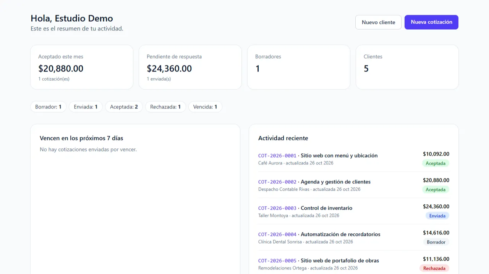
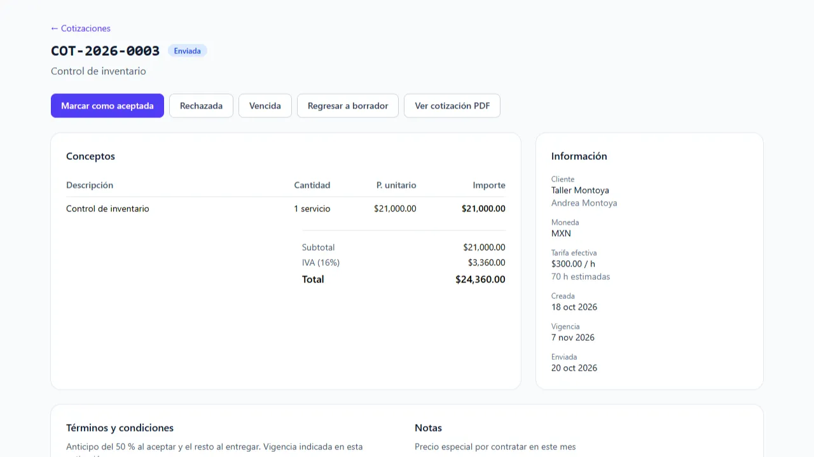
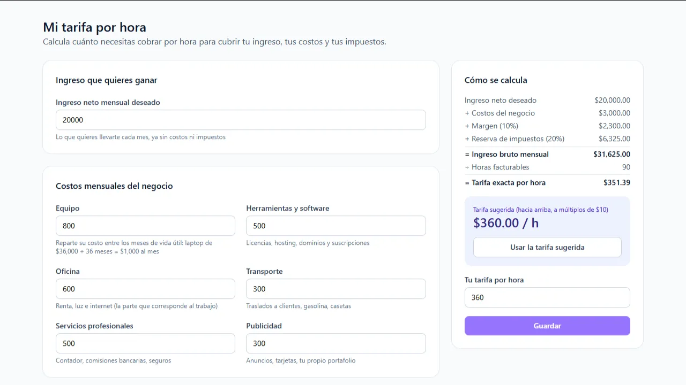
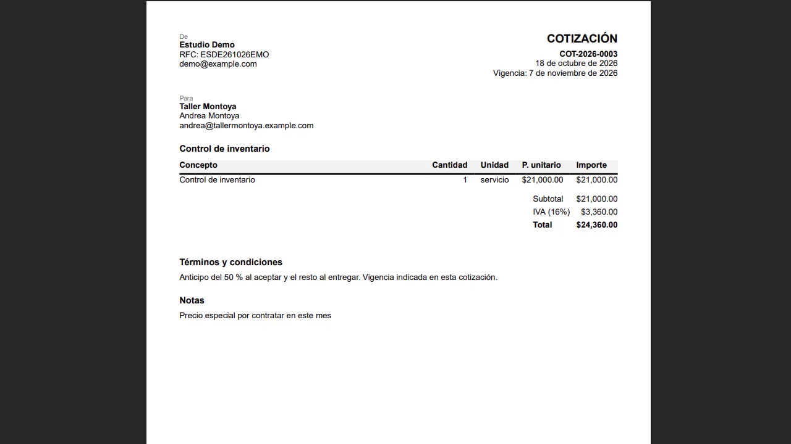

*Actualizado el 26 de octubre de 2026.*

## El problema

Un freelancer en México necesita cotizar con IVA, RFC y un folio consecutivo, dar seguimiento a cada propuesta y, si se acepta, entregar un contrato. Las hojas de cálculo no controlan estados ni evitan errores de redondeo. Y casi nadie sabe cuánto vale realmente su hora, así que cotiza a ojo.

Lo construí como práctica de NestJS y React con TypeScript, con un caso de uso que conozco de primera mano. Hoy lo uso con mis propios clientes.

## Qué hace

- Alta y búsqueda de clientes.
- Editor de cotizaciones con conceptos dinámicos y totales en vivo.
- Flujo de estados: borrador → enviada → aceptada, rechazada o vencida.
- PDF de la cotización (con marca de agua mientras es borrador) y PDF del contrato al aceptarse.
- Panel con montos aceptados del mes, pendientes por moneda y cotizaciones por vencer.
- Calculadora de tarifa por hora y catálogo de servicios con horas estimadas.

## Ponerle precio a mi trabajo

Cotizar bien no es solo sumar conceptos: hay que saber cuánto vale una hora. El cotizador calcula una tarifa a partir del ingreso mensual deseado, los costos, el margen, la reserva de impuestos y las horas facturables.

Cada servicio del catálogo lleva horas estimadas, y cada cotización muestra su **tarifa efectiva**: lo que realmente cobras por hora. Si baja de tu tarifa objetivo, esa cotización te paga menos de lo que vale tu tiempo, y lo sabes antes de enviarla.

Si quieres ver el otro lado, mi [calculadora de ROI](/roi) muestra al cliente cuánto le conviene el proyecto; el cotizador es donde ese trabajo se cotiza y se formaliza.

## Arquitectura

Monorepo con pnpm: API en NestJS con Prisma y PostgreSQL, y una SPA en React con Vite. En producción, Vercel sirve el frontend y reenvía `/api` a Render, así que navegador y API comparten origen. Neon aloja la base de datos.

## Decisiones técnicas

- **Dinero con `Decimal` en una función pura.** El cálculo de importes, IVA y total vive en una función sin dependencias del framework, con redondeo *half-up* a dos decimales y pruebas unitarias (por ejemplo, 3 × 0.1 = 0.3 exacto). Los totales se guardan en columnas `Decimal(12,2)`.
- **El backend es la fuente de verdad.** El frontend replica el cálculo en centavos enteros solo para la vista previa.
- **Folio atómico.** El consecutivo por usuario se incrementa dentro de la misma transacción que crea la cotización, con una restricción única como respaldo.
- **Máquina de estados declarativa.** Una tabla define las transiciones válidas y el cambio se aplica con una actualización condicionada al estado actual, para evitar carreras.
- **Autenticación sin Passport.** Access token corto en memoria y refresh token opaco en cookie *httpOnly*, guardado como hash, con rotación y detección de reuso. Guard global y respuestas 404 ante recursos ajenos.
- **Instalación personal, superficie mínima.** El registro se cierra solo en cuanto existe un usuario, y la API limita las peticiones. El número de proxies de confianza se midió contra la cadena real de Render para que el límite use la IP correcta.
- **PDF con pdfmake**, sin navegador *headless*, para que el contenedor sea ligero.

## Calidad y despliegue

- Pruebas e2e contra PostgreSQL real: autenticación, aislamiento entre usuarios, cotizaciones, validación, límites de peticiones, tarifa y catálogo de servicios.
- Cada push a `main` ejecuta lint, build, pruebas e imágenes Docker; luego, tras una aprobación manual, aplica migraciones, despliega la API y espera a que el *health check* reporte el commit exacto.
- Un respaldo diario de la base se cifra con `age` y se guarda fuera del repositorio. Probé la restauración completa antes de darlo por bueno.

El código es público: [github.com/cemendez/cotizador](https://github.com/cemendez/cotizador).

## Qué mejoraría

- Un paquete compartido para que el cálculo y las transiciones no estén duplicados entre API y web.
- Ampliar las pruebas del frontend.
- Marcar como vencidas, con una tarea programada, las cotizaciones enviadas cuya vigencia ya pasó.
- Limitar los intentos de inicio de sesión también por cuenta, no solo por IP.

¿Necesitas una herramienta a la medida para cotizar, dar seguimiento a clientes o automatizar tareas administrativas de tu negocio? [Escríbeme](/#contact) y lo platicamos.